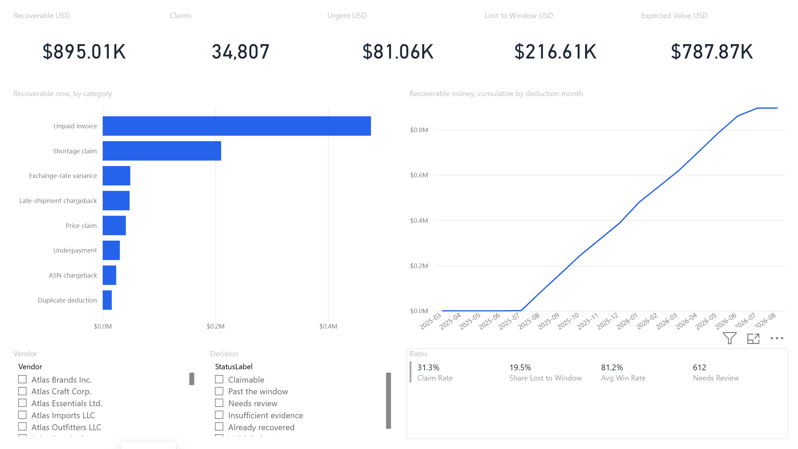
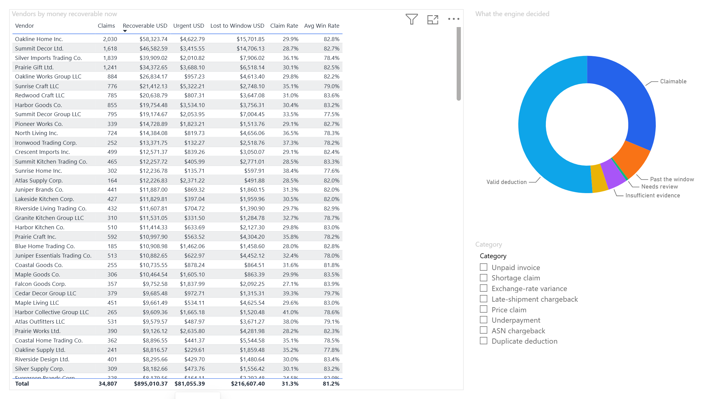
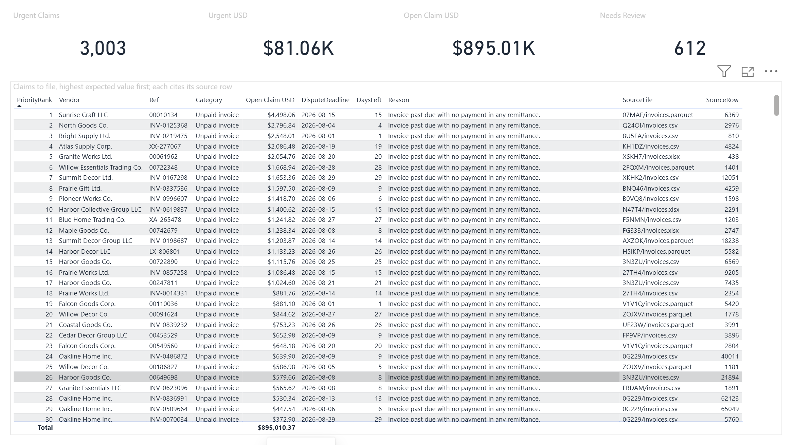
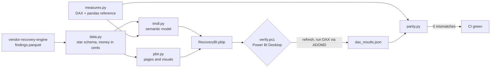

# recovery-bi

**A Power BI report generated as code, from data to published-ready project, with every DAX
measure checked against an independent reference on Power BI's own engine.**

[](https://github.com/jmnzcn/recovery-bi/actions/workflows/ci.yml)




<sub>The Overview page as Power BI Desktop renders the generated project. Nothing on it was placed by hand.</sub>

A .pbix is a binary nobody can review. A Power BI Project (.pbip) is a folder of text: the
semantic model in **TMDL**, the report in **PBIR** (one JSON per page and per visual). This repo
writes all of it from Python: a star schema from
[vendor-recovery-engine](https://github.com/jmnzcn/vendor-recovery-engine)'s 111,224 findings,
14 DAX measures, three report pages. Then it proves the numbers.

Part of a series on Amazon vendor deduction recovery:
[vendor-recovery-engine](https://github.com/jmnzcn/vendor-recovery-engine) (batch engine) →
[deduction-stream](https://github.com/jmnzcn/deduction-stream) (real time on Kafka) →
[dispute-agent](https://github.com/jmnzcn/dispute-agent) (AI analyst under guardrails) →
**recovery-bi** (the report finance reads).

## Results

| Check | Result |
|---|---|
| **DAX vs reference, evaluated by Power BI Desktop's engine** | **17,885 cells, 0 mismatches** across totals, 8 categories, 6 statuses, 170 vendors, 1,188 vendor × category pairs and the monthly running total |
| Reference vs the engine's own totals | $895,010.37 recoverable · $216,607.40 lost to the window · 34,807 claims · 3,003 urgent ($81,055.39): exact |
| Generated files vs Microsoft's published JSON schemas | 29 of 29 valid |
| Semantic model in Microsoft's Tabular Object Model | parses and validates: 5 tables, 36 columns, 14 measures, 4 relationships |
| Rebuild | byte-identical; the committed project is exactly what the generator writes |

**What the parity check caught.** The first run in Power BI found 56 cells that disagreed, all in
`Claim Rate`. Where a vendor and category had findings but no claims, `[Claims]` is BLANK, and
`DIVIDE(BLANK, n)` is BLANK too: the report would have shown an empty cell where the answer is
0 %. The fix is one token (`[Claims] + 0`) and the reason sits next to it in
[`measures.py`](src/recovery_bi/measures.py). A second run caught nothing, and the running total
was then changed to stop at the last deduction instead of drawing a flat line to 2027.

## The report

| Overview | Vendors | Work queue |
|---|---|---|
|  |  |  |
| What is recoverable now, by category and over time; what is urgent and what was lost | Every vendor ranked by money recoverable, with claim and win rates | Claims to file in priority order, each citing the vendor's file and row that proves it |

## How it works



| Check | Where | Needs Power BI |
|---|---|---|
| Every JSON file against Microsoft's published schemas | CI | no |
| TMDL parsed and validated by Microsoft's Tabular Object Model | CI (.NET on Linux) | no |
| Model rules: explicit measures only, money summed in cents and divided once, single-direction many-to-one relationships, hidden keys, marked date table | CI | no |
| Every field a visual uses exists; visuals fit the page without overlapping | CI | no |
| Committed project equals a fresh build | CI | no |
| DAX parity | recorded with `scripts/verify.ps1`, re-checked in CI | to record |

The DAX engine ships only with Power BI, so parity is recorded on Windows and committed; CI
recomputes the reference and compares. A change to the data, a measure or the reference that was
not re-verified in Power BI fails the build. Design notes and trade-offs: [docs/design.md](docs/design.md).

## Run it

```bash
python -m venv .venv && .venv/Scripts/activate        # or source .venv/bin/activate
pip install -e ".[dev]"
pytest -q                                             # schemas, model rules, reference, recorded parity

recovery-bi export ../vendor-recovery-engine/out      # rebuild data/*.parquet from the engine's output
recovery-bi build                                     # regenerate powerbi/ (what is committed)
recovery-bi build --local                             # out/powerbi, pointing at this checkout: open it in Power BI Desktop
dotnet run --project tools/DaxRunner -- validate powerbi/RecoveryBI.SemanticModel/definition
```

On Windows with Power BI Desktop installed:

```powershell
.\scripts\verify.ps1 -KeepOpen    # build, open, refresh, run the DAX in Power BI, compare every cell
.\scripts\screenshots.ps1          # capture each page into docs/img
```

## Repository map

| Path | What it is |
|---|---|
| `src/recovery_bi/data.py` | star schema from the engine's findings, with referential checks |
| `src/recovery_bi/measures.py` | the 14 measures: DAX, format, folder, description, pandas reference |
| `src/recovery_bi/tmdl.py` | the semantic model as TMDL |
| `src/recovery_bi/pbir.py` | the report as PBIR: pages, visuals, fields, sort, theme |
| `src/recovery_bi/parity.py` | the DAX queries and the cell-by-cell comparison |
| `tools/DaxRunner` | .NET: validate TMDL (TOM), refresh and query Power BI Desktop's engine (ADOMD) |
| `powerbi/` | the generated Power BI project |
| `parity/` | the queries, the results recorded from Power BI, the report |
| `data/` | the exported star schema (synthetic data) |

## Limits

- The data is synthetic: vendor-recovery-engine's generated world, with known answers.
- Layout is declared in code and checked for bounds and overlaps; how it looks is checked by eye.
- Parity needs Power BI Desktop (Windows) to record; elsewhere, the recorded results are checked.

## Resumen en español

Un reporte de Power BI generado completamente con código: el modelo en TMDL, las páginas y
visuales en PBIR, todo desde Python. Cada medida DAX tiene una implementación independiente en
pandas y se compara celda por celda contra el motor de Power BI Desktop (17.885 celdas, 0
diferencias). La primera corrida encontró un error real: `Claim Rate` devolvía vacío en vez de 0 %.
CI valida contra los esquemas oficiales de Microsoft y con su Tabular Object Model.

## License

MIT
